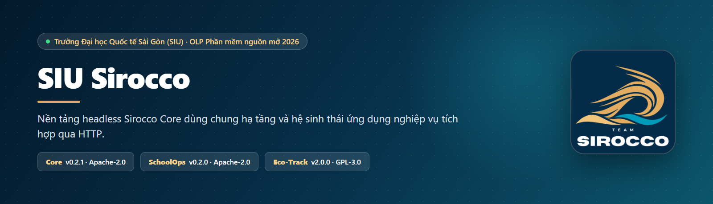
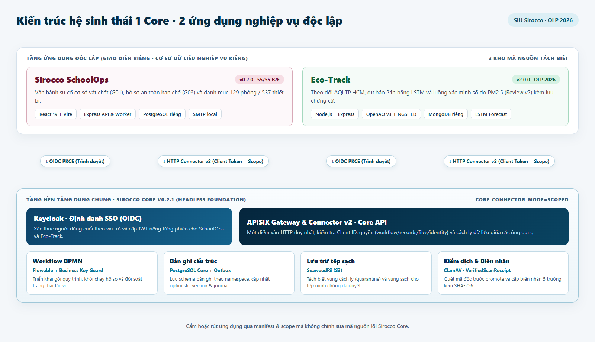

<h3>Đội sinh viên Trường Đại học Quốc tế Sài Gòn (SIU) phát triển nền tảng headless Sirocco Core và hệ sinh thái ứng dụng tích hợp qua API cho OLP Phần mềm nguồn mở 2026.</h3>

  
  
  
  
  

---

## Kiến trúc hệ sinh thái 1 Core · 2 ứng dụng độc lập

Mỗi ứng dụng sở hữu kho mã nguồn, giao diện và cơ sở dữ liệu nghiệp vụ riêng, kết nối với **Sirocco Core** qua HTTP để dùng chung định danh SSO, bộ máy quy trình BPMN, bản ghi cấu trúc và lưu trữ tệp có kiểm dịch.

  

## Trình diễn trực quan

  

## Các dự án và bản phát hành chính thức

| Dự án | Vai trò trong hệ sinh thái | Công nghệ chính | Bản phát hành | Trạng thái kho |
| --- | --- | --- | --- | --- |
| **Sirocco Core** | Nền tảng headless cung cấp SSO OIDC, Gateway phân quyền, Flowable BPMN, bản ghi cấu trúc và lưu trữ tệp kiểm dịch ClamAV. | Node.js, TypeScript, APISIX, Keycloak, Flowable, PostgreSQL, SeaweedFS, ClamAV | `v0.2.1` · Apache-2.0 | Lưu trữ nội bộ (`private`) trước khi công bố |
| **Sirocco SchoolOps** | Ứng dụng vận hành cơ sở vật chất trường học (G01), hồ sơ an toàn hạn chế theo ACL (G03) và quản trị danh mục 129 phòng / 537 thiết bị. | React 19, Vite, Express, PostgreSQL riêng, Playwright E2E (55/55) | `v0.2.0` · Apache-2.0 | Lưu trữ nội bộ (`private`) trước khi công bố |
| [**Eco-Track**](https://github.com/SIU-Sirocco-2025/Eco-Track) | Hệ thống quan trắc &amp; dự báo chất lượng không khí TP.HCM (OpenAQ v3, LSTM 24h, NGSI-LD), tích hợp xác minh số đo PM2.5 (`review-v2`) qua Core. | Node.js, Express, MongoDB riêng, OpenAQ v3, LSTM | [`v2.0.0`](https://github.com/SIU-Sirocco-2025/Eco-Track/releases/tag/v2.0.0) · GPL-3.0 | **Công khai** (`SIU-Sirocco-2025/Eco-Track`) |

## Nguyên tắc thiết kế kỹ thuật

- **Phân tách dữ liệu nghiệp vụ**: SchoolOps dùng PostgreSQL riêng; Eco-Track dùng MongoDB riêng; Core chỉ quản lý danh tính, tiến trình BPMN, biên nhận tệp và bản ghi theo namespace được cấp phép.
- **Cắm/rút ứng dụng qua Connector v2 (`CORE_CONNECTOR_MODE=scoped`)**: Ứng dụng mới kết nối bằng manifest, nhận `Client ID` và scope giới hạn từ Gateway mà không sửa mã nguồn Core.
- **Kiểm dịch tệp trước sử dụng**: Mọi tệp minh chứng đều qua vùng cách ly trên SeaweedFS và quét ClamAV trước khi nhận `VerifiedScanReceipt` kèm SHA-256.
- **Kiểm chứng tái lập theo `SOURCE-REVISION`**: Gói phát hành đi kèm mã băm `SHA256SUMS`, SBOM CycloneDX, danh mục phụ thuộc và biên nhận kiểm thử tự động theo đúng commit phát hành.

## Khám phá mã nguồn

- Kho công khai: [SIU-Sirocco-2025/Eco-Track](https://github.com/SIU-Sirocco-2025/Eco-Track) và [các bản phát hành Eco-Track](https://github.com/SIU-Sirocco-2025/Eco-Track/releases).
- Các kho thuộc tổ chức (hiển thị với tài khoản đã được cấp quyền): [Danh sách kho SIU Sirocco](https://github.com/orgs/SIU-Sirocco-2026/repositories).
