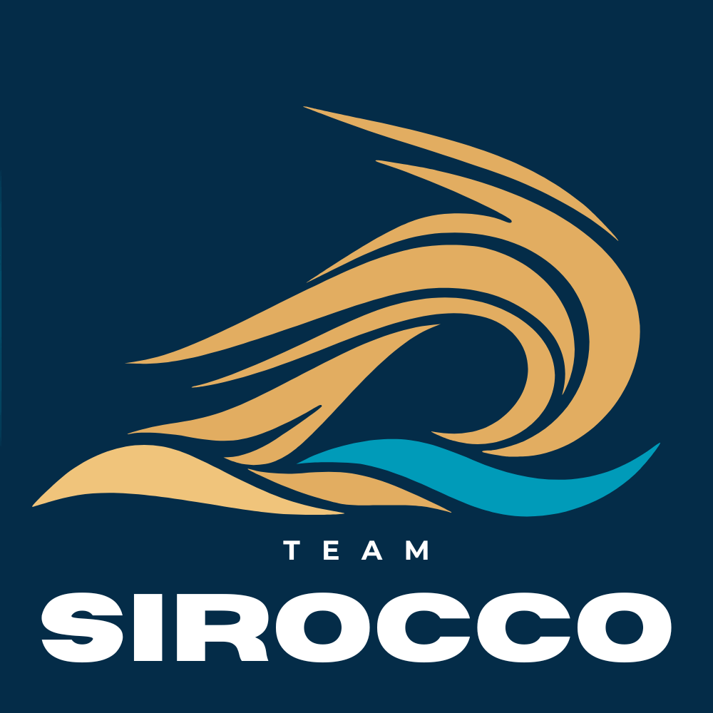
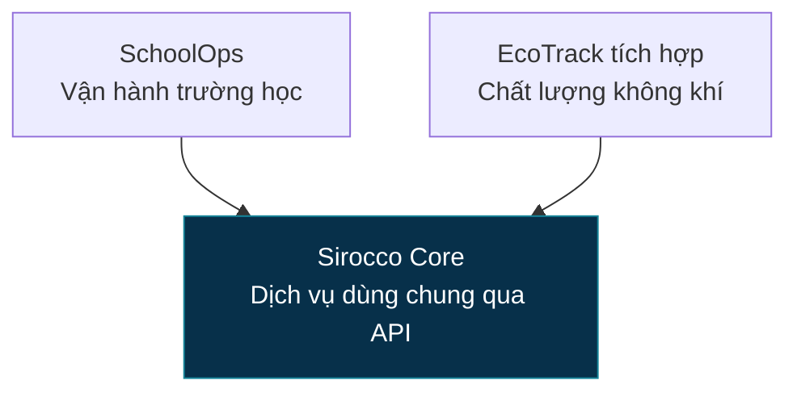

  

<h1 align="center">SIU Sirocco</h1>

Đội sinh viên Trường Đại học Quốc tế Sài Gòn. Chúng tôi phát triển Sirocco Core và tích hợp các dịch vụ dùng chung qua API vào ứng dụng thực tế.

## Các dự án

| Dự án | Bài toán |
| --- | --- |
| **Sirocco Core** | Cung cấp đăng nhập, workflow, bản ghi và lưu trữ tệp có kiểm dịch cho backend ứng dụng. |
| **EcoTrack** | Theo dõi chất lượng không khí. Bản tích hợp với Core hỗ trợ xác minh nguồn dữ liệu PM2.5 và theo dõi phản ánh. |

## Khám phá mã nguồn

[EcoTrack 2025](https://github.com/SIU-Sirocco-2025/Eco-Track) là bản độc lập công khai của đội. Bản EcoTrack trong sơ đồ là phiên bản tích hợp Sirocco Core. Xem [các bản phát hành EcoTrack 2025](https://github.com/SIU-Sirocco-2025/Eco-Track/releases) hoặc mở [danh sách kho SIU Sirocco](https://github.com/orgs/SIU-Sirocco-2026/repositories) để xem các kho tài khoản của bạn có quyền truy cập.
