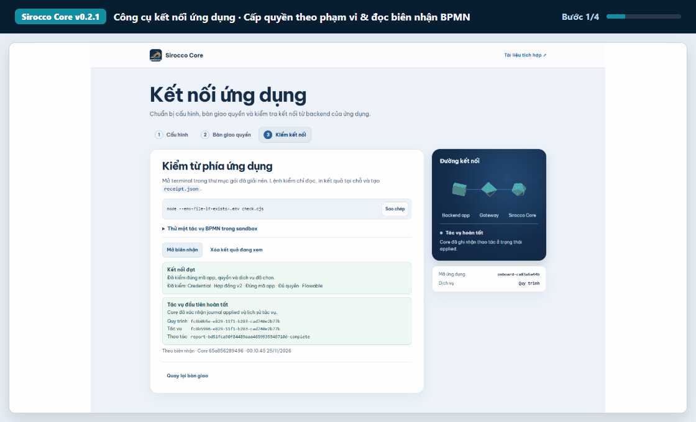

<h3>Đội sinh viên Trường Đại học Quốc tế Sài Gòn (SIU) phát triển nền tảng headless Sirocco Core và hệ sinh thái ứng dụng tích hợp qua API cho OLP Phần mềm nguồn mở 2026.</h3>

  
  
  
  
  

---

## Kiến trúc hệ sinh thái 1 Core · 2 ứng dụng độc lập

Mỗi ứng dụng sở hữu kho mã nguồn, giao diện và cơ sở dữ liệu nghiệp vụ riêng, kết nối với **Sirocco Core** qua HTTP để dùng chung định danh SSO, bộ máy quy trình BPMN, bản ghi cấu trúc và lưu trữ tệp có kiểm dịch.

  

## Trình diễn trực quan

  

## Các dự án và bản phát hành chính thức

| Dự án | Vai trò trong hệ sinh thái | Công nghệ chính | Bản phát hành | Trạng thái kho |
| --- | --- | --- | --- | --- |
| **Sirocco Core** | Nền tảng headless cung cấp SSO OIDC, Gateway phân quyền, Flowable BPMN, bản ghi cấu trúc và lưu trữ tệp kiểm dịch ClamAV. | Node.js 22, TypeScript, APISIX, Keycloak, Flowable, PostgreSQL, SeaweedFS, ClamAV | `v0.2.1` · Apache-2.0 | Lưu trữ nội bộ (`private`) trước khi công bố |
| **Sirocco SchoolOps** | Ứng dụng vận hành cơ sở vật chất trường học (G01), hồ sơ an toàn hạn chế theo ACL (G03) và quản trị danh mục 129 phòng / 537 thiết bị. | React 19, Vite, Express, PostgreSQL riêng, Playwright E2E (55/55) | `v0.2.0` · Apache-2.0 | Lưu trữ nội bộ (`private`) trước khi công bố |
| [**Eco-Track**](https://github.com/SIU-Sirocco-2025/Eco-Track) | Hệ thống quan trắc &amp; dự báo chất lượng không khí TP.HCM (OpenAQ v3, LSTM 24h, NGSI-LD), tích hợp xác minh số đo PM2.5 (`review-v2`) qua Core. | Node.js 22, Express, Pug, MongoDB riêng, OpenAQ v3, Python LSTM | [`v2.0.0`](https://github.com/SIU-Sirocco-2025/Eco-Track/releases/tag/v2.0.0) · GPL-3.0 | **Công khai** (`SIU-Sirocco-2025/Eco-Track`) |

## Bốn trụ cột kỹ thuật OLP PMNM 2026

| Trụ cột | Thiết kế thực thi | Kết quả xác minh |
| --- | --- | --- |
| **Phân tách tầng Headless** | SchoolOps dùng PostgreSQL riêng; Eco-Track dùng MongoDB riêng; Core chỉ giữ Identity, Flowable, bản ghi theo namespace và tệp kiểm dịch. | Không trộn bảng dữ liệu nghiệp vụ vào Core |
| **Cắm/rút ứng dụng qua Connector v2** | Cấp `Client ID` và scope giới hạn (`CORE_CONNECTOR_MODE=scoped`), giảm quyền sau cài đặt, đọc chéo tài nguyên trả `HTTP 404`. | Đạt cả kiểm thử HTTP độc lập và 2 ứng dụng chạy song song |
| **Kiểm dịch tệp trước khi dùng** | Tải lên vùng cách ly SeaweedFS → ClamAV quét → `promoteWithReceipt()` trả 5 trường `VerifiedScanReceipt` kèm SHA-256. | Tệp chưa sạch bị chặn trước bước nghiệm thu G01 và `review-v2` |
| **Đối soát &amp; Tái lập** | Outbox/journal giữ `operationId` khi mất phản hồi; mỗi bản phát hành kèm `SOURCE-REVISION`, `SHA256SUMS`, SBOM CycloneDX và CI xanh. | 56 unit test Core + 55 E2E SchoolOps + unit OIDC/outbox Eco-Track |

## Khám phá mã nguồn và Cộng đồng

- **Kho công khai:** [SIU-Sirocco-2025/Eco-Track](https://github.com/SIU-Sirocco-2025/Eco-Track) và [các bản phát hành Eco-Track](https://github.com/SIU-Sirocco-2025/Eco-Track/releases).
- **Kho trong tổ chức** (hiển thị với tài khoản đã được cấp quyền): [Danh sách kho SIU Sirocco](https://github.com/orgs/SIU-Sirocco-2026/repositories).
- **Quy chuẩn cộng đồng:** [Hướng dẫn đóng góp](https://github.com/SIU-Sirocco-2026/.github/blob/main/CONTRIBUTING.md) · [Quy tắc ứng xử](https://github.com/SIU-Sirocco-2026/.github/blob/main/CODE_OF_CONDUCT.md) · [Chính sách bảo mật](https://github.com/SIU-Sirocco-2026/.github/blob/main/SECURITY.md) · [Giấy phép Apache-2.0](https://github.com/SIU-Sirocco-2026/.github/blob/main/LICENSE).
